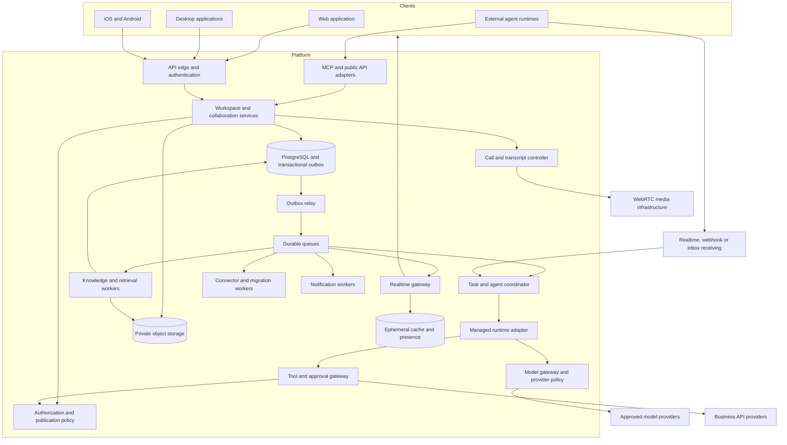
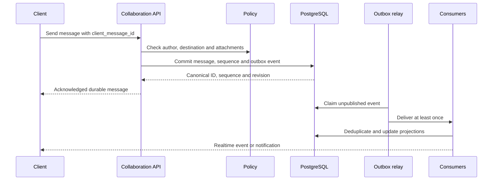
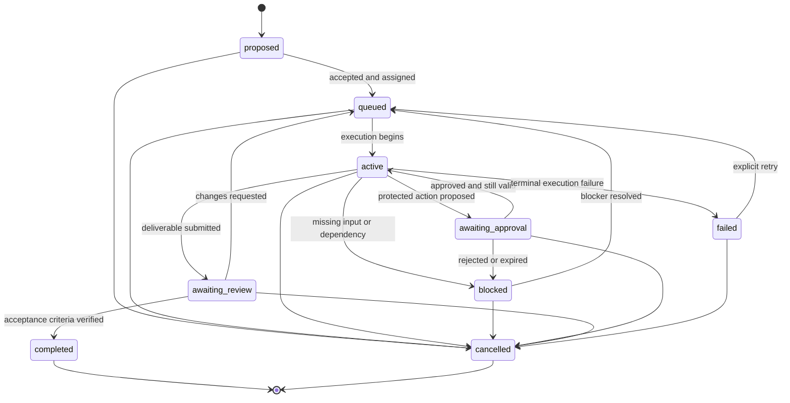

# AgentOrchestration — Production Architecture

**Status:** Target production design; implementation is underway. See [implementation status](docs/implementation.md) for delivered behavior, local development choices, tests, and outstanding release gates.

**Scope:** The complete product specified in the [product specification](docs/product-specification.md).

**Last reviewed:** October 24, 2026.

This document describes an original implementation for an Ando-like product. It does not describe Ando's private infrastructure. Public product research informs the required behaviors; storage, topology, protocols, state machines, and operational targets below are our engineering decisions.

The delivered collaboration slice now includes distinct channel/direct/group records, unique direct-member pairs, independent group ownership, versioned participant changes, targeted access-revocation events, and conversation-filtered audit activity. Private attachments use provider-bound metadata and upload leases, composite message links, quota reservations, signature-based previews, authenticated downloads, and an asynchronous purge worker. See [current conversation/file behavior and production configuration](docs/implementation.md#direct-messages-private-groups-and-attachments). Development uses private local disk and an explicitly unscanned development state; production configuration requires private S3-compatible storage and ClamAV. Private-group history now uses explicit membership intervals and consent-bound retained-history expansion; see [messaging implementation](docs/messaging.md).

The delivered notification/activity slice adds recipient-bound notification records with transactional delivery, source-authorized inbox queries and targeted invalidations; category/conversation preferences; explicit mention identities; and bounded message-context navigation. Presence/typing use session-bound PostgreSQL leases with revisions, current conversation authorization and periodic ephemeral SSE snapshots, separate from durable outbox publication. See [notification/activity behavior and operational limits](docs/implementation.md#notifications-presence-and-typing). Mobile/web push, notification email, quiet hours and fleet-scale ephemeral fan-out remain target release work.

The implemented messaging organization layer adds sequence-based membership history grants and consent records, personal message collections, versioned drafts, a transactional scheduled-message dispatcher, encrypted browser composition/outbox storage, and bounded client timelines. See [messaging implementation](docs/messaging.md) for the implemented consistency and authorization boundaries.

The work-management layer adds participation and human acceptance records, immutable artifact/revision ledgers, task-to-run associations, transactional workflow events and step outputs, audience-bound portfolio reporting, captured business calendars, and fenced external calendar synchronization. Workflow/provider execution and production boundaries are documented in [work management](docs/work-management.md).

## 1. Architectural commitments

The delivered identity layer now distinguishes global accounts, organization membership, workspace membership, and session assurance. Existing workspace tenants are backfilled beneath organizations. Account-only sessions cannot authorize content; selected-workspace sessions revalidate current organization policy, and SSO assurance is bound to the actual destination organization. Guest/service audiences add restrictive database policies above tenant RLS. MFA seeds, IdP secrets and pending PKCE verifiers use context-bound authenticated encryption; OIDC/SAML state and SCIM revocation live in PostgreSQL. See [identity implementation and operating boundaries](docs/identity.md) for schema, setup, protocols and lifecycle checks. Physical regional infrastructure, full erasure, custom role catalogs and future connector/automation offboarding remain separate target work.

1. PostgreSQL is the canonical store for workspace data, permissions, messages, tasks, approvals, and execution records.
2. Human and agent memberships use the same authorization boundary. Operational services have explicit capabilities rather than implicit access to all content.
3. Agent execution is asynchronous. Sending a message never waits for a model, connector, embedding, or transcription job.
4. Domain changes and corresponding outbox events commit in one database transaction. Event transport is at least once; consumers deduplicate.
5. An agent's identity, the person requesting work, the credential used by a tool, and the destination audience are distinct fields.
6. Every retrieval and publication checks current access. Memory, summaries, files, and generated answers inherit source restrictions.
7. Durable task state belongs to the platform. Runtime-specific session state belongs to the runtime adapter and can be replaced without rewriting task ownership.
8. Agent runtimes cannot access the application database or integration vault directly. They operate through scoped platform tools.
9. External side effects are mediated by a tool gateway with policy, approval, idempotency, and reconciliation records.
10. Core messaging remains available when optional intelligence services fail.

## 2. Logical topology



The diagram shows logical boundaries, not a requirement to deploy every box as a separate service. Start with a modular collaboration backend and independently deployed realtime, worker, runtime, and media components. Split backend modules only when ownership, load, isolation, or release independence justifies it. A complete product does not require a microservice for every feature.

## 3. Technology and deployment defaults

These are concrete defaults for planning. Pin supported versions and validate provider limits during implementation; do not treat the names below as working integrations.

| Concern | Proposed default | Reason and boundary |
| --- | --- | --- |
| Language and contracts | TypeScript, shared schemas, generated OpenAPI clients | Consistent validation across web, API, workers, and agents |
| Web | React and Next.js | Application shell, authenticated UI, accessible components |
| Core backend | Fastify domain API in a container service | Explicit modules and predictable long-lived worker integration |
| Desktop | Electron with signed updates and isolated renderer | Shared UI and mature desktop integration; benchmark resource usage |
| Mobile | React Native with native notification and media modules | Shared contracts with platform-specific UX and lifecycle handling |
| Primary data | Managed PostgreSQL with RLS and pgvector | Transactional state plus permission-aware lexical/vector retrieval |
| Ephemeral state | Redis | Presence, fan-out assistance, bounded caches, rate limiting; never sole durable work storage |
| Files and recordings | S3-compatible private object storage | Multipart uploads, lifecycle policies, versioning, regional placement |
| Event delivery | Transactional outbox feeding SQS queues | Durable fan-out and backpressure; application-level deduplication remains required |
| Managed agents | eve behind a platform runtime adapter | Durable agent sessions, tools, schedules, and versioned behavior |
| Models | Vercel AI Gateway through a platform model adapter | Central routing and usage capture; approved direct/BYOK adapters where needed |
| Media | LiveKit | WebRTC rooms, video/audio, screen sharing, recording integration |
| Identity | OIDC/SAML provider behind an identity adapter | Enterprise federation and MFA without implementing password infrastructure |
| Billing | Stripe behind a billing adapter | Subscriptions, invoices, webhook-driven reconciliation |
| Telemetry | OpenTelemetry plus managed metrics/logs/traces | End-to-end correlation without dependence on a single observability vendor |
| Infrastructure | Terraform-managed environments | Repeatable networking, services, storage, queues, and secrets |

### 3.1 Reference deployment

- **Application data plane:** AWS ECS/Fargate for the core API, realtime gateway, outbox relay, and connector/knowledge workers; managed PostgreSQL, Redis, SQS, object storage, and KMS in a selected region.
- **Web delivery:** Next.js deployment on Vercel, calling the regional data plane. Authentication cookies/tokens must respect the actual origin and session design; do not expose service credentials to the browser.
- **Managed agent plane:** eve in its supported deployment environment, initially on Vercel. It calls the platform tool gateway with run-scoped credentials. All runtime checkpoints, model requests, logs, and artifacts are part of the data-residency assessment.
- **Media:** A region-selected LiveKit deployment or managed service with an explicit recording destination.
- **External runtimes:** Customer-operated processes connecting through public interfaces. The platform does not assume it controls their uptime, filesystem, model provider, or retention.

This reference uses more than one infrastructure provider. Select nearby compatible regions, measure cross-provider latency/egress, and document each data transfer. If a customer requires a single approved boundary, qualify a compliant runtime/model deployment before enabling hosted agents for that tenant. Do not promise strict residency based solely on the database region.

### 3.2 Runtime selection and portability

Use eve as the initial managed-agent implementation, consistent with its documented durable-agent model. Its installed, versioned documentation must govern actual API usage. Keep a small adapter contract: `start`, `signal`, `cancel`, `status`, `exportArtifacts`, and `health`.

The platform coordinator owns task assignment, inbox delivery, spending reservations, approval decisions, and public status. The runtime owns its execution checkpoints and model/tool loop. Do not add a second workflow engine that retries the same tool call independently. A separate durable workflow service may handle migration or deletion jobs, but one system must own each workflow's retry state.

Before committing to production, validate cancellation, checkpoint recovery, version pinning, maximum run duration, concurrency, trace export, data retention, and region support with the selected eve deployment. An adapter is a portability boundary, not proof that every runtime can satisfy these requirements.

## 4. Domain ownership

| Module | Owns | Must not own |
| --- | --- | --- |
| Identity | Accounts, memberships, invitations, sessions, role bindings | Conversation content or model reasoning |
| Collaboration | Conversations, messages, threads, reactions, read state | Agent retry policy |
| Files | Upload authorization, scanning, metadata, access checks | Public permanent download URLs |
| Tasks | Task graph, assignments, accepted outcomes, blockers | Provider-side side-effect truth |
| Agents | Agent definitions, versions, activation, ownership, runtime registry | Unrestricted credentials |
| Coordinator | Inbox, run admission, leases, schedules, delegation budgets | Direct third-party mutations |
| Tool gateway | Typed actions, policy decisions, approvals, execution ledger | Deciding that a model suggestion grants authority |
| Knowledge | Wiki revisions, scoped memory, provenance, retrieval | Expanding a source's audience automatically |
| Integrations | Connections, provider subscriptions, mappings, sync cursors | Bypassing platform permissions |
| Media | Room authorization, recording state, transcript lifecycle | Automatically making private calls searchable workspace-wide |
| Notifications | Ranking, batching, routing, delivery receipts | Canonical task or message state |
| Commercial | Entitlements, seat history, usage ledger, billing reconciliation | Inferring usage solely from provider invoices |
| Governance | Audit, retention, holds, export, deletion, regional policy | Unlogged general administrative access |

Every write passes through the owning module's application service. Workers may read constrained projections, but do not mutate another module's tables as an undocumented shortcut.

## 5. Identity, tenancy, and authorization

### 5.1 Identity layers

- `account`: A signed-in human identity, potentially a member of multiple workspaces.
- `organization`: Billing, enterprise identity, and regional policy boundary.
- `workspace`: Collaboration tenant and default data ownership boundary.
- `principal`: A human, agent, or narrowly defined operational service identity.
- `membership`: A principal's workspace-specific role and lifecycle state.
- `credential`: A scoped authorization to act as one membership in one workspace.
- `requester`: The membership asking an agent to perform work.
- `connection_owner`: The person or workspace owning a third-party account connection.

An agent can be the message author while a tool acts through a particular human's authorized account. The audit record must retain both identities and the original requester. Clients cannot supply an arbitrary author ID to impersonate another membership.

### 5.2 Authorization evaluation

Allow an operation only when all relevant conditions pass:

```text
active identity and membership
AND credential audience, expiry, and scope
AND workspace and resource policy
AND conversation or artifact access
AND agent role and capability grants
AND requester/delegation authority for this action
AND connection owner consent and provider permissions
AND resource/tool restrictions
AND valid approval, when policy requires one
AND publication audience constraints
```

RBAC controls broad roles; resource grants and attributes narrow individual operations. A guest does not inherit ordinary public-channel discovery. Public means public to eligible members of this workspace, not the internet or other organizations.

Administrators manage the workspace without automatically reading all private conversations. Emergency or compliance access requires a separate permission, stated purpose, and audit event.

### 5.3 Database enforcement

Tenant-owned tables carry `workspace_id`. Composite foreign keys include tenant identity so a valid object ID from one workspace cannot be referenced from another. Unique constraints are tenant-scoped where appropriate.

Enable row-level security and use non-owner application roles without `BYPASSRLS`. Use `FORCE ROW LEVEL SECURITY` where required. Set authenticated tenant context inside each transaction; never leave mutable tenant context on a pooled connection. RLS is a second barrier alongside application policy, not a replacement for resource and publication authorization. PostgreSQL documents owner and superuser exceptions explicitly. [PostgreSQL RLS reference](https://www.postgresql.org/docs/current/ddl-rowsecurity.html)

Migration and maintenance roles are separate from application identities. Workers receive an explicit tenant and operation scope. Any cross-tenant administrative operation uses a dedicated, audited path.

The current implementation enables and forces RLS on workspaces and all workspace-bearing tables, including sessions and knowledge versions. The database adapter binds `ao.workspace_id` and an allowlisted role using transaction-local settings on the connection executing the query. Missing tenant context yields no tenant rows and rejects inserts. The runtime startup rejects owner/superuser/BYPASSRLS connections. Migration jobs use a separate credential. See [deployment and isolation details](docs/implementation.md#database-isolation-and-production-credentials).

The trusted identity path resolves credentials, invitations and account memberships across workspaces through `ao_identity`; it cannot read conversation content. The dispatcher can enumerate workspace IDs, and `ao_worker` executes within one workspace at a time. These roles currently share a trusted server process. RLS protects against omitted tenant predicates and pooled context leakage; a compromised server able to select arbitrary tenant context remains inside this trust boundary. Private-conversation access and human role authority continue to require application checks.

The identity implementation now includes hashed, purpose-bound verification/recovery proofs; account credential epochs; global session revocation; and an encrypted transactional email outbox with a leased provider-bound delivery worker supporting Gmail SMTP and Resend. An explicitly selected Mailpit transport captures development mail through loopback SMTP and is rejected in production. It preserves the same proof checks, encryption, leases and payload erasure; provider-bound jobs cannot be rerouted to a live service by changing configuration. SMTP uncertainty is recorded without automatic replay; Resend retries retain its provider idempotency key. Account proofs and security events use forced identity-only RLS. Invitation mail is tenant-scoped, and tenant reads cannot retrieve encrypted payloads. Runs and approvals check the current credential epoch through a tenant-bound authority function, so password recovery invalidates old execution authority as well as browser sessions. See [email delivery and recovery](docs/implementation.md#transactional-email-verification-and-recovery) for implemented deadlines, retries, configuration and remaining operational work.

### 5.4 Shared channels

A shared channel has one owning workspace and explicit participating-workspace grants. Guest membership in the shared channel does not make another workspace's public channels visible. Every message records the owning and originating workspace.

Federated membership, allowed agent participation, recording, export, and retention policies are negotiated at the channel boundary. Reject incompatible policies rather than silently choosing the least restrictive one. Revoking an organization removes future service access; it cannot erase copies the organization already legitimately received.

### 5.5 Membership history and changing audiences

Each conversation declares whether a newly added member can read retained history or only content after joining. Default ordinary channels to retained history and sensitive private conversations to an explicit invitation-time choice. Explain the resulting access before inviting an agent or external participant. A private group expansion grants only post-join content unless existing participants unanimously approve retained-history sharing. Existing membership intervals and history floors remain explicit, so the new participant cannot inherit an earlier grant.

Store membership intervals and history grants so message, file, transcript, search, and memory checks apply the same rule. Removing a participant revokes service access to that conversation, including historical content, while preserving audit attribution. Rejoining does not automatically recover a prior history grant. A change from private to public is an audited audience-expansion action with explicit approval and a preview of affected artifacts.

## 6. Canonical data model

The following is a schema inventory, not executable DDL. Use opaque IDs, UTC timestamps, explicit version fields, and composite tenant keys. Store provider IDs separately from platform IDs.

| Entity group | Core records and important fields |
| --- | --- |
| Organization | `organizations`, `workspaces`: owner, home region, policy version, plan, lifecycle |
| Identity | `accounts`, `principals`, `memberships`, `role_bindings`, `invitations`, `sessions` |
| Authorization | `resource_grants`, `credential_scopes`, `policy_versions`, `access_epochs` |
| Conversations | `conversations`, `conversation_members`, `shared_channel_grants`: kind, visibility, history policy |
| Messages | `messages`: conversation, thread root, author membership, body, revision, sequence, origin, tombstone |
| Message detail | `message_versions`, `reactions`, `attachments`, `pins`, `read_cursors`, `drafts` |
| Files | `files`, `file_versions`: object key, scan state, MIME, checksum, audience, retention |
| Agents | `agents`, `agent_versions`, `agent_channel_settings`, `runtime_registrations`, `agent_health` |
| Receiving | `agent_inbox`, `inbox_leases`, `subscriptions`: event reference, state, expiry, attempts |
| Execution | `runs`, `run_steps`, `run_artifacts`, `run_signals`: task, runtime, session scope, config version |
| Tasks | `tasks`, `task_assignments`, `task_dependencies`, `task_transitions`: owner, acceptance criteria, version |
| Delegation | `delegations`: parent task/run, child task, recipient, authority, budget, deadline, depth |
| Tool execution | `tool_invocations`, `approval_requests`, `approval_decisions`: parameters digest, connection, effect state |
| Knowledge | `knowledge_pages`, `page_versions`, `dictionary_entries`, `decision_records`, `channel_journals` |
| Memory | `memory_items`, `source_links`, `derived_artifact_sources`: owner, audience, validity, supersession |
| Retrieval | `search_chunks`, `embeddings`, `index_watermarks`: source/version, audience reference, model version |
| Connections | `app_connections`, `connection_grants`, `tool_policies`, `provider_subscriptions`: secret reference only |
| Migration | `migration_jobs`, `source_id_mappings`, `sync_cursors`, `sync_conflicts`, `import_checksums` |
| Calls | `calls`, `call_participants`, `recording_consents`, `transcript_segments`, `call_artifacts` |
| Automation | `automation_definitions`, `automation_versions`, `schedule_occurrences`, `automation_runs` |
| Notifications | `notification_preferences`, `notifications`, `delivery_attempts`, `device_tokens` |
| Commercial | `subscriptions`, `seat_intervals`, `usage_events`, `budget_reservations`, `invoice_reconciliations` |
| Reliability | `outbox_events`, `consumer_receipts`, `idempotency_records`, `workflow_checkpoints`, `dead_letters` |
| Governance | `audit_events`, `retention_policies`, `legal_holds`, `export_jobs`, `deletion_jobs` |

### 6.1 Required invariants and indexes

- Message uniqueness: `(workspace_id, conversation_id, sequence)` and `(workspace_id, actor_id, client_message_id)`.
- Imported source uniqueness: `(workspace_id, provider, source_workspace_id, source_object_type, source_object_id)`.
- Thread root must belong to the same conversation and tenant as its reply.
- Stable author attribution survives display-name changes and offboarding.
- Read cursors advance monotonically; unread projections can be rebuilt from canonical messages and preferences.
- Agent inbox uniqueness: `(agent_id, source_event_id, activation_kind)`.
- Consumer receipt uniqueness: `(consumer_name, event_id)`; receipt and consumer's domain mutation commit together where possible.
- Tool action uniqueness: `(workspace_id, logical_action_id)`; retain the request digest and reject conflicting reuse.
- Approval uniqueness binds action, approver, policy version, expiry, and exact approved parameters.
- Tasks and knowledge revisions use optimistic concurrency; incompatible updates return a conflict instead of overwriting.
- Index message timelines by tenant/conversation/sequence; inbox by agent/state/available time; tasks by tenant/owner/state; outbox by publication state/time.
- Use source revision checks to prevent late indexing jobs from resurrecting deleted or replaced material.

## 7. Messaging and realtime contracts

**Implemented:** The current API/web application uses authenticated SSE backed by committed outbox publication, versioned author edits and guarded tombstone deletion, idempotent reactions, and separate monotonic channel/thread read positions. Publication locks a tenant head independently of domain writes, preventing late-committing source IDs from being lost on reconnect. Public IDs and audience-bound encrypted cursors hide internal sequence positions; event delivery filters current channel access and carries references rather than private bodies. Independent API instances share publication state through PostgreSQL. Broker fan-out and the broader envelope below remain target architecture; see [implemented messaging behavior and operating limits](docs/implementation.md#live-messaging-edits-reactions-and-read-receipts).

### 7.1 Message write path



Lock the conversation's sequence counter during the message transaction, or use an equivalent single-writer partition. This establishes order within a conversation without claiming global order. Allocate independent event revisions for edits and deletes. Avoid relying on client clocks for ordering.

The API returns after durable commit. A realtime or indexing outage cannot roll back a sent message. The client reconciles its optimistic local item using `client_message_id` and the canonical message ID.

### 7.2 Event envelope

```json
{
  "event_id": "evt_example",
  "schema_version": 1,
  "event_type": "message.created",
  "workspace_id": "ws_example",
  "aggregate_type": "conversation",
  "aggregate_id": "conv_example",
  "aggregate_version": 731,
  "actor_membership_id": "member_example",
  "causation_id": "request_example",
  "correlation_id": "workflow_example",
  "occurred_at": "2026-10-23T10:00:00Z",
  "payload": { "message_id": "msg_example", "revision": 1 }
}
```

Prefer references over complete private bodies in event payloads. Consumers fetch permitted content when needed. Do not expose tenant-wide event IDs, counts, or gaps to clients if doing so reveals inaccessible activity.

### 7.3 Fan-out and recovery

- Maintain independent queues/consumer receipts for realtime, notifications, search, knowledge, and agent routing.
- Outbox relay publishes, waits for broker acknowledgement, then marks publication. A crash between those steps produces a duplicate, which is expected.
- Consumers handle out-of-order events by checking aggregate revision or refetching canonical state. Standard queue delivery does not establish conversation order.
- WebSocket subscriptions are authorized at connection and at subscription changes; revoke subscriptions when access changes.
- Issue short-lived socket tickets instead of placing long-lived API keys in URLs.
- Resume uses an opaque, authorized cursor. If the replay window has expired, return `resync_required` and fetch a new snapshot.
- Presence and typing indicators may expire or disappear; message delivery may not.
- Mobile push is a wake-up hint, not the message transport. The application fetches authorized canonical state after waking.
- Apply slow-client backpressure and disconnect/resync rather than allowing unlimited per-client buffers.

The web client treats access revocation as an immediate authority invalidation, independent of coalesced content refresh work. It clears affected caches/editors, fences obsolete bootstrap responses, and reconciles current membership before loading conversation content on full resynchronization. This prevents a denied old conversation from blocking recovery. Deterministic coalescing, missed-event and delayed-snapshot browser cases supplement the real-SSE revocation flow; the continuous integration workflow covers embedded/standalone PostgreSQL and production-web browser tests.

## 8. Agent lifecycle and receiving work

### 8.1 Configuration and authority

An agent definition contains an owner, immutable published configuration version, instructions, runtime type, model policy, tool grants, conversation grants, proactivity policy, and budgets. Updating a definition creates a version; active runs retain the version they started with unless explicitly cancelled and restarted.

Runtime types are `managed`, `external_local`, and `external_cloud`. Each declares supported features such as cancellation, checkpoints, file output, streaming, and concurrent sessions. A capability declaration must be verified by onboarding tests before the UI promises it.

Lifecycle: `invited -> active -> paused -> archived`. Revocation invalidates credentials, stops new work, cancels managed runs, revokes tool access, and marks any external runs as revoked/unconfirmed until acknowledged. Revocation cannot recall content already sent to an external machine.

### 8.2 Inbox and leases

Activation events create durable inbox entries. Receipt states are `pending`, `leased`, `accepted`, `completed`, `dead_letter`, and `cancelled`.

1. A receiver claims an entry with a bounded lease and fencing token.
2. It creates or recovers a unique run keyed by inbox item and activation policy version.
3. It acknowledges acceptance only after durable run registration.
4. The coordinator tracks run liveness separately from delivery acceptance.
5. Expired leases become claimable; stale fencing tokens cannot mutate the replacement run.
6. Completion records refer to task or run results; transport acknowledgement alone does not mean the work is done.

Disconnected agents retain inbox work until its configured expiry. Show backlog and connection health. Coalesce superseded context notifications, but preserve distinct assignments and approvals.

### 8.3 External agent contract

Expose three receive mechanisms: authorized realtime wake-ups, signed HTTPS webhooks, and polling of a durable inbox. Realtime and webhook messages can carry only an inbox reference; the receiver retrieves current authorized context.

MCP supplies tools to a running client. It is not a process supervisor or a substitute for an event receiver. External runtimes must supply their own listener, scheduling, availability, and local execution controls. This distinction is also explicit in Ando's public developer documentation. [Ando MCP reference](https://docs.ando.so/docs/ando-mcp)

Outbound webhook deliveries use a timestamp, delivery ID, HMAC signature, bounded retries with jitter, and a dead-letter view. Receivers must deduplicate and reject replay outside a configured window. A `2xx` confirms delivery acceptance, not task completion.

## 9. Execution, tasks, delegation, and approvals

### 9.1 Task and run separation

A task is an accountable unit of work with acceptance criteria. A run is one execution attempt. A task may outlive many runs, models, owners, and reviews. A chat thread is evidence and discussion, not the sole task database.



Record state transitions with expected version, actor, reason, and evidence. System policy can allow automated verification for deterministic outcomes; human judgment is required where acceptance criteria cannot be verified mechanically.

### 9.1.1 Delivered advanced task model

The implementation extends canonical tasks with a creator, immutable source audience, optional parent, calendar due date, metadata version and assignment delivery version. A creator, assignee or current human administrator manages work within the source ACL; active readers can discuss it. Creation and comment posting have actor-scoped retry identities. Human completion still requires evidence, and state transitions are retained as immutable version-addressed history. Existing approved agent tool creation retains its source and agent creator/assignee.

Subtasks and explicit prerequisites form one directed completion graph: parent → child plus task → prerequisite. Links require the same exact source conversation or workspace-wide scope. A workspace advisory transaction lock serializes graph changes across API instances; task writes take workspace authority before graph/member/conversation/row locks, while comment-only writes use source/task locks without traversing the graph. Recursive reachability validates cycles across both kinds of edge. Deferred database constraints recheck graph/audience/completion consistency at commit. This covers concurrent reverse links, reparenting, late subtasks and parent completion. Completed prerequisites gate executing/review/completed states; completed or cancelled children gate parent completion/cancellation. Neither cancellation cascades nor automatic dependent execution is implied.

Calendar due dates deliberately have no time-of-day. Clients specify the calendar date used for overdue filters; the web supplies the user's local date and API defaults use UTC. Due/priority/creation lists use bounded indexed keysets, with independently labeled AES-GCM cursors bound to the viewer and exact filters. Source ACLs remain canonical on every continuation; live metadata edits can reorder results. Direct relation lists, comment discussion and transition evidence also expose bounded pagination. The initial array API remains compatible.

Task discussion uses immutable per-task positions and original creation fingerprints. Only an author may edit; the author or an authorized human administrator may replace the body with a deletion tombstone. Version guards prevent lost edits. Active source-authorized human creators, assignees and previous discussion participants receive recipient-private in-app notifications according to their Tasks preference/mute policy. Assignment generation is tracked independently from metadata versions. Audit, outbox and notifications share the source transaction; deleted/private sources never supply cached notification text. The UI preserves conflicting drafts for explicit review and clears source content after authority revocation.

Migrations 023–026 provide graph/comment tables with forced tenant RLS and composite references, source/version/graph guards, retry keys, participant/order indexes and immutable state evidence. No externally executed work occurs while graph locks are held. Task attachments, bulk actions, Kanban, recurrence, reminders and the calendar extend this model as described below. Fleet contention and very large graphs require performance qualification. Exact contracts are in [advanced task implementation](docs/implementation.md#advanced-task-management).

### 9.1.2 Delivered task scheduling and calendar

Recurrence is a durable rule attached to a source task, independently versioned from task metadata. Daily, weekly and anchored monthly intervals produce local calendar dates; PostgreSQL converts their configured local creation times and lead days to instants. Rules retain the original anchor, next index/date/instant, inclusive end date, pause reason, authorizing human and occurrence count. Month-end clamping does not drift the anchor. Extending an ended rule resumes its next index. Rule edits can re-anchor calculation without duplicating an existing recurrence/date identity. Source completion does not implicitly alter a schedule.

The API’s tenant-bound scheduling worker takes the existing workspace/graph lock before materializing independent proposed tasks. It rechecks the authorizing human’s active status, current management rights, source ACL and assignee eligibility, with conversation locks serializing membership mutations. Invalid authority pauses the rule for review. Each new occurrence copies the current source metadata and reminder configuration; its due date is the occurrence date. Relationships, comments and verification evidence stay attached to their original tasks. The occurrence ledger, task insert, audit/notification/outbox records and next cursor advance commit together. Multiple replicas and crash retries share the same unique occurrence identity.

A task reminder configures a local time/time zone and days-before offset. Its durable delivery identity includes configuration version, task due-date generation and assignment generation. The worker targets a current active human assignee or an unassigned task’s creator, applies inbox/category/mute preferences, and excludes terminal work. Suppression is itself recorded to prevent later preference changes from replaying old reminders. Delivery rows, recipient-private notifications and targeted outbox invalidations commit together. Inbox queries revalidate configuration, assignment, due date, task state and source access; current titles are projected on read. Unrelated task metadata updates preserve delivery identity.

The worker runs every 30 seconds, processes at most 50 occurrence advances and 100 reminders per workspace per pass, catches up durable backlog after downtime, isolates workspace failures and drains on shutdown. No provider request runs under a graph lock. Advance creation supports reminders before due; late-created tasks catch up on their next eligible pass. This implementation delivers in-app reminders. It does not imply email/push delivery or an external calendar provider.

Migrations 027–028 add forced tenant RLS and composite references for recurrence, immutable occurrence and reminder-delivery ledgers, plus reminder settings, due-date generations and minute/time-zone validation. Schedule updates require one-step versions; runtime/worker roles cannot delete schedule/ledger rows or update ledger identities. Production retains the non-owner role boundary.

The Calendar tab combines cursor-paginated due-date windows with separately paginated recurrence previews. Preview windows are bounded to 63 dates and calculated on demand; reads never materialize work. Already generated dates, inaccessible sources and paused/ended rules are excluded. The UI labels previews and explicitly offers additional pages until the month is complete. Recurring schedule management includes paused and ended rules. See [scheduling contracts and guarantees](docs/implementation.md#recurring-tasks-reminders-and-calendar) for semantics, limits and operational qualifications.

### 9.1.3 Delivered task files, atomic actions and Kanban

Files can now be bound to a task rather than a conversation message. A file reservation stores an immutable task ID and its exact source audience; conversation ID is nullable only for workspace-only task files. Composite task/file references and source triggers prevent cross-task reuse, audience changes and attaching task bytes to a message. Task managers use the existing checksum/scanning/private storage pipeline; active readers access attached files through current source checks. Management is revalidated after scanning/storage I/O. No provider call runs while a SQL lock is held.

Task attachment links have actor attribution, guarded versions and retained removal markers. Attach validates the full set before changing any link, serializes on the task, and commits file state, audit and live invalidations together. Existing link identities make retries safe. Removal immediately revokes access and hands byte deletion/quota recovery to the existing cleanup worker. Limits are 25 MiB per file, 10 files per attachment batch and 100 active files per task; listing uses indexed UUID keysets. Attachments are independent of task metadata versions and are not implicitly copied to recurring occurrences.

Bulk actions share the existing task policy primitives instead of maintaining separate mutation rules. A batch takes workspace/graph authority, locks up to 50 distinct targets in stable UUID order, verifies access/management/expected versions, then applies metadata or state changes. Graph constraints are validated against the final batch state, including parents and children verified together. Each newly completed task retains its own human evidence and immutable transition record. Any failure rolls back all task/history/audit/notification/outbox changes. Exact no-ops do not advance versions.

A workspace/actor/client-key ledger stores only the request fingerprint and resulting IDs/versions. It commits in the same transaction as the task changes. Concurrent or uncertain-response retries return the original result after current authorization checks; a different payload cannot reuse the key. Bulk previews expose only currently manageable tasks. The UI preserves selected versions across live invalidations and requires explicit review after conflicts.

Kanban is an alternate view over the canonical task list and transition APIs. All nine states have independently paginated, source-authorized columns; filters and indexed sorting are shared with List. Dragging changes state without a second board-specific state machine. Keyboard/touch move controls use the same path, completion opens an evidence dialog, and failed moves refresh current state. Column counts explicitly distinguish loaded cards from complete results. This implementation does not add custom columns, manual within-column ranking or task hard deletion.

Migration 029 adds forced-RLS attachment links, task/file composite identities and immutable audience guards, plus the append-only bulk request ledger. Existing non-owner runtime/worker roles retain the tenant boundary. See [task file, bulk and Kanban contracts](docs/implementation.md#task-attachments-bulk-actions-and-kanban).


### 9.1.4 Delivered projects, milestones and task labels

Projects organize tasks within one immutable audience: workspace-wide or one conversation. Project access reuses the current conversation policy, including direct/group participant membership. Project ownership is management authority over project metadata and milestones; it does not expand source visibility or grant task management. Active human creators, current owners and human workspace administrators with source access can manage projects. Task creators, assignees and human administrators retain the existing task policy when assigning work to accessible open projects. A task and project must share an exact source, including workspace-wide versus a public conversation.

Projects have planned/active/paused/completed/archived status, an active human owner, description, start/target dates, optimistic versions, and task progress. Milestones belong to one immutable project and have planned/active/completed/cancelled status, description, due date, versions and task progress. Completion rejects open tasks; cancelled tasks count as closed but remain distinct from completed progress. Archived projects and completed/cancelled milestones refuse new placement. Catalog entities are retained rather than hard-deleted.

Migrations 030–032 add projects, milestones, workspace labels and task/label links with forced tenant RLS and composite workspace references. Task placement and organization entities use the existing workspace graph advisory lock. Deferred SQL constraints enforce completion after task state/placement changes, and immutable source/revision guards defend direct writes. API writes recheck current human/manager/source policy under the same lock and atomically commit domain changes plus audit/outbox records. UUID request IDs and immutable fingerprints deduplicate project, milestone and label creation; updates require captured versions.

Labels are a workspace-visible catalog with case-insensitive unique names, six fixed colors, creator/administrator management and versioned archive/restore. Archived labels remain on existing tasks and in historical filters but cannot be newly assigned. A task has at most 20 labels, and a workspace catalog has at most 1,000 labels including archived entries. Label metadata changes emit workspace events; labels must not contain private conversation content. Task label replacement advances the task version once and participates in the atomic bulk request ledger.

List, Kanban and Calendar accept project/milestone/label filters. Catalogs and selectors use bounded UUID pagination; task lists retain signed, filter-bound keyset cursors. Project and milestone progress reads count tasks sharing the same authorized audience. Recurring occurrences copy current placement and active labels. Closed project or milestone placement pauses recurrence execution for explicit review, and calendar previews exclude those schedules. No new project-specific ACL, independent project chat or automatic task state changes are introduced. Large portfolios and contention still require production load qualification. See [project contracts and guarantees](docs/implementation.md#projects-milestones-and-task-labels).

### 9.2 Run admission and lifecycle

Admission checks activation policy, current access, deduplication, concurrency limits, workspace budget, model availability, and task state. Reserve an upper-bounded spending allowance before starting.

Run states: `queued`, `running`, `waiting_tool`, `waiting_approval`, `waiting_input`, `succeeded`, `failed`, `cancelled`, `outcome_unknown`.

Each run stores parent/root run, task, conversation, requester, agent version, runtime session ID, lease epoch, access epoch, step count, usage, deadline, and checkpoint reference. Persist progress and tool intent before executing external effects. Cancellation is cooperative for running providers; revoke future tool access immediately and reconcile any in-flight side effect.

The public trace contains actions, observations, source references, approvals, and outcomes. Do not require storage or disclosure of private model chain-of-thought.

### 9.3 Multi-agent handoffs

A delegation creates a child task with an explicit recipient, accepted authority, narrowed tool/resource scope, output contract, deadline, and budget. It does not grant the recipient access to everything the parent agent knows.

Use a delegation graph with a common root correlation ID. Defaults for planning: maximum depth 4, maximum 20 descendants per root, and no recursive delegation to an ancestor without a new human instruction. These are configurable product policies, not measured optimal values.

Only the assigned owner or authorized coordinator changes canonical task status. Other agents submit artifacts and review results. Use task version checks and run fencing to prevent two workers from finalizing the same assignment.

### 9.4 Preventing runaway conversations

- Distinguish a direct assignment from an ordinary agent message.
- Never let every agent message automatically wake every agent.
- Carry root event, causation chain, hop count, and total budget through every handoff.
- Suppress repeated agent pairs and semantically unchanged responses within a bounded window.
- Require a pending task, explicit mention policy, or measurable new information for automatic continuation.
- End a run on completion, missing authority, exhausted budget, unchanged state, or deadline.
- Use a workspace kill switch, per-agent pause, and task-level cancellation.

### 9.5 Approval and tool execution protocol

```text
proposal
  -> typed parameter validation
  -> current authorization and publication checks
  -> policy decision
  -> approval required? persist exact action and wait
  -> recheck authority, policy, source revisions, approval and budget
  -> reserve logical action ID in execution ledger
  -> execute through connection proxy
  -> verify provider result or mark outcome_unknown
  -> record evidence, usage and audit event
```

An approval binds the exact normalized action digest, tool version, provider account, resources, destination, approver, policy version, and expiry. Changed parameters require new approval. Approvals are consumed for one logical action; retries of that same action reuse its ledger entry rather than execute a new operation.

Some providers accept idempotency keys; use them. If a request times out after the provider may have acted, query by provider operation ID or other reliable evidence. If verification is impossible, mark `outcome_unknown` and require reconciliation. Do not claim exactly-once effects across arbitrary third-party APIs.

## 10. Knowledge, memory, and information-flow control

### 10.1 Three distinct stores

| Store | Purpose | Authority |
| --- | --- | --- |
| Conversation record | What participants actually said and attached | Canonical communication history |
| Shared knowledge | Approved facts, decisions, procedures, scoped summaries | Versioned workspace/channel content with sources |
| Agent memory | Agent-specific working preferences and learned procedures | Derived, scoped, correctable material; never an access grant |

Every derived artifact records source IDs and revisions, audience, authoring method, generation time, validity, and superseded state. A confidence score is metadata, not evidence of truth.

### 10.2 Retrieval pipeline

1. Authenticate the requesting identity and determine the output destination audience.
2. Construct the authorized source set using current memberships and resource grants.
3. Retrieve lexical and vector candidates within that set, with bounded fallback when approximate filtering produces too few results.
4. Hydrate canonical source revisions and recheck access before sending text to a model.
5. Rank for relevance, authority, freshness, and contradiction; retain source links.
6. Generate an answer with citations and explicit uncertainty where evidence is missing.
7. Recheck output audience and source validity before publication.

Cache keys include workspace, principal, audience fingerprint, permission epoch, query, and index version. Invalidate access immediately on revocation. Never return unfiltered snippets, counts, previews, or nearest-neighbor scores from inaccessible documents.

### 10.3 Preventing cross-conversation leakage

An agent may read a private executive conversation and also belong to a public engineering channel. That does not authorize repeating executive information in engineering.

Use separate runtime sessions by workspace, agent, task, and audience boundary. A broad agent-global transcript is prohibited. Context assembly includes only sources whose audiences allow use at the output destination, unless an authorized person explicitly forwards or declassifies selected content.

By default, a derived artifact's audience is the intersection of its sources' audiences. For a public response, require all source material used by that run to be publishable there. Prompting the model to keep secrets and output classifiers are supplemental controls; they do not replace segregated context and server-side policy.

When access changes, invalidate affected run contexts/checkpoints for reuse and restart from permitted sources. Check approval and membership again before every tool call and publication. An external runtime cannot be made to forget previously downloaded information; state that limitation in the connection contract.

### 10.4 Knowledge synthesis and correction

Scheduled synthesis processes eligible journals into candidate updates with evidence links. Workspace-wide synthesis uses workspace-readable sources only. Private-channel synthesis stays inside that audience.

Canonical decisions and human corrections are versioned, not overwritten by later summarization. Contradictory claims are surfaced for resolution rather than averaged into an invented consensus. Unsupported statements are rejected from automatic publication.

Deletion or restriction of a source immediately hides dependent derived content from retrieval/publication. Background jobs remove or recompute chunks, summaries, embeddings, memories, and artifacts using the provenance graph. Regeneration cannot use the deleted source. Backup restoration reapplies deletion tombstones before serving traffic.

### 10.5 Search scaling

Start with PostgreSQL full-text search and pgvector behind a search interface. Keep canonical ACL checks in the platform. Add a dedicated search engine when measured corpus size, relevance requirements, or index load justifies it. A secondary index is rebuildable and does not become the permission authority.

### 10.6 Delivered search, message history and knowledge revision contracts

The current modular backend implements lexical search directly over canonical PostgreSQL message and knowledge rows, with expression-matched GIN indexes, full-text web search syntax and source ACLs in the query. It excludes deleted messages before ranking. Filter-bound, viewer-bound AES-GCM cursors carry rank/timestamp/UUID keysets with a 24-hour expiry; cursor state uses a separately labeled derivation from the stable deployment cursor key. Cursors preserve timestamp microseconds and rank text across round trips. A continuation always rechecks current access. It is a live search, not a frozen export: edits can reorder results, and live client invalidation restarts the query. Migrations 049–056 add a source-aware cross-content chunk index, portable exact vectors, actor-bound embedding jobs, retained transcripts, file text/OCR extraction, inspectable memory/releases, scoped connector imports and revocation epochs. The existing advanced endpoint remains available; the new retrieval API uses Unicode lexical terms, optional real embeddings, current-access hydration/publication checks and cited extractive answers. Source references are cached per actor/credential/account/policy rather than caching plaintext. See [retrieval and connection implementation](docs/retrieval-and-connections.md) for bounds, source authority, supported provider operations and remaining qualification. A separate search service is deferred until production measurements justify it.

The history API selects bounded chronological windows by immutable conversation sequence, independently for root messages and each thread, using exclusive `before`/`after` boundaries or a UUID anchor. Tombstones occupy their original sequence. Current message hydration includes attachments, reactions and receipt aggregates. Conversation access and thread/anchor scope are checked on every request; no page number or sequence acts as authorization. The client maintains independently paged timelines, merges by ID/sequence, restores the scroll offset when prepending and revalidates its loaded range on live invalidations. Revalidation cost currently grows with the loaded window; virtualization and high-volume qualification remain performance work.

Knowledge writes preserve the creator and source conversation. An active human reader can edit the page. A write locks workspace authority and current membership, the source conversation, then the page, checks an expected version and appends a full attributed snapshot. A unique page/request UUID and canonical request hash recognize retries before checking the old expected version. The response distinguishes the applied revision from the latest current page, avoiding false conflicts after a committed response is lost or another editor subsequently publishes. Restoring an old snapshot is the same guarded append operation with restore provenance; it never rewinds the version or erases intervening history.

Database migrations 021–022 add indexes, request/restore metadata, immutable revision enforcement, fixed page identity/audience, one-step version advancement and deferred constraints requiring a published page to match its latest stored snapshot at commit. The guards apply to both interactive and approved-tool writes. Audit/outbox records commit with the edit or restore. Historical snapshots inherit the page's current source ACL; new membership checks prevent replaying an old cursor or opening a cached revision after removal. The UI fences old requests and clears private bodies/drafts on authority revocation. It retains a conflicting draft in memory for explicit review and supports retrying the original uncertain save.

Exact endpoint schemas and delivered limitations are in [implementation status](docs/implementation.md#search-history-and-knowledge-editing). Existing array-style message/search endpoints remain compatible. These components do not yet supply distributed collaborative cursors, rich-text simultaneous editing, semantic search or source-derived synthesis.

## 11. Integrations, credentials, and executable tools

### 11.1 Connection model

A connection stores provider, owner type, secret reference, granted scopes, allowed resources, allowed consumers, token health, and lifecycle. Secrets are encrypted under KMS and never included in model context, event payloads, application logs, or downloadable traces.

A personal connection defaults to acting only for its owner's requests. Delegating access for team requests requires a separate explicit grant. Workspace ownership does not make every tool available to every member or agent.

The credential proxy checks each action and supplies credentials only to the provider adapter. Connector workers and model runtimes cannot export raw refresh tokens. Rotate and revoke credentials, invalidate cached sessions, and stop queued operations using revoked grants.

### 11.2 Tool registry

Every tool has a versioned schema, read/write classification, resource selector, expected side effect, approval policy, timeout, idempotency strategy, reconciliation method, cost metadata, and result redaction rules. Raw provider permission scopes are not sufficient to describe safe execution.

Use typed operations for common business actions. Generic SQL and shell execution require dedicated sandboxes, resource boundaries, and stricter policy. Database tools use constrained database identities; a prompt-level instruction to avoid writes is not a read-only control.

### 11.3 MCP server and public API

The MCP server adapts the same domain operations used by the application API. OAuth selects the workspace and acting identity; API keys are scoped to one identity. A tool argument cannot change attribution or expand permissions.

Follow the pinned MCP HTTP authorization specification, including protected-resource metadata, discovery, resource audience validation, and appropriate OAuth client protections. Do not assume that all clients support the same optional features. [MCP authorization specification](https://modelcontextprotocol.io/specification/2026-07-28/basic/authorization)

Provide stable core tools for identity, conversations, messages, tasks, knowledge, calls, and files. Discover connected-app tools separately to keep the default catalog bounded. Filter both tool discovery and execution by grants; omission from discovery alone is not security.

Version contracts, preserve old clients during a migration window, publish deprecations, and test full live schemas. Credentials, tool catalog versions, and deployed server versions are distinct concepts.

### 11.4 Untrusted content and sandboxing

Messages, documents, webpages, tool responses, email, and imported history are data. They cannot change system policy, grant credentials, approve an action, or redirect a tool to an unauthorized destination.

Run generated code in isolated, disposable sandboxes with network egress restrictions, bounded filesystem access, time/CPU/memory limits, and short-lived scoped capabilities. Custom MCP URLs and webhook targets require SSRF protections, address revalidation, redirect controls, and blocked private/metadata endpoints unless an explicit private-network connector is configured.

Interactive mini-apps run in sandboxed frames on a separate origin. Their server actions require ordinary authorization, schema validation, CSRF protection where relevant, and audit. Never execute model-generated application code inside the main application origin or privileged backend.

## 12. Calls, transcripts, and recording

The media controller creates a provider room associated with a conversation and issues short-lived participant tokens after access checks. The media plane transports audio/video; the collaboration service owns membership, recording policy, and artifact permissions.

Recording/transcription state is server-authoritative. Display it before joining and after changes. Persist consent/policy decisions without copying transcript content into audit logs.

| Mode | Live behavior | Persistent behavior |
| --- | --- | --- |
| No recording | Media transport only | Call metadata and permitted participant records |
| Transient transcription | Authorized live captions | Caption text discarded; provider temporary buffers governed by contract |
| Retained recording | Visible recording and transcription | Private media objects, transcript, reviewable summary and chapters |

Transcription segments have stable IDs, speaker attribution confidence, timing, and revisions. Corrected transcripts trigger targeted re-indexing. A summary links to segments; extracted tasks are proposals until accepted by an accountable person or approved workflow policy.

Transcript-consuming agents do not need media access. A live speaking agent is a separate room participant with explicit consent, a narrow context audience, interruption controls, and a visible owner. Recording access and live speech permissions are separate grants.

## 13. Notifications and proactivity

Keep three decisions independent: whether an event creates work, whether an agent should execute, and whether a person should be interrupted.

Use deterministic policy for direct assignments, approvals, failure escalation, and quiet hours. A model may rank optional activity, but cannot suppress required operational alerts or bypass recipient controls.

Deduplication keys include recipient, underlying event, reason, and delivery channel. Do not resend unchanged failures on every scheduler tick. Batching preserves links to individual items. A task deadline can escalate according to policy with an explanation of why the person was notified.

Per-agent proactivity controls apply per conversation. A cheap eligibility filter precedes expensive model evaluation. Track accepted contributions, dismissals, interventions, and cost. Prefer silence when no actionable difference exists.

### 13.1 Automations and recurring work

An automation definition binds a versioned instruction/template, owner, execution identity, trigger, input source, destination, tool grants, budget, and failure policy. Recheck that identity and its grants on every occurrence. Owner offboarding pauses automations until an authorized person transfers ownership.

Store the original schedule, IANA timezone, daylight-saving policy, and next UTC occurrence. Specify whether repeated local times run once or twice, how nonexistent local times move, and whether missed occurrences are skipped, coalesced, or replayed. Use a unique occurrence key based on automation version and scheduled instant. Scheduler retries may recover an occurrence but cannot create a second logical run.

Define overlap behavior per automation: skip, queue, or allow bounded concurrency. Event-driven rules deduplicate provider event IDs and carry causation chains to prevent a workflow from repeatedly triggering itself. A periodic reconciliation sweep finds missed scheduled work; it does not blindly rerun completed side effects. Provide owner-visible run history, pause/resume, upcoming occurrences, and an explicit policy for failure escalation.

## 14. Migration and synchronization

Treat migration as a durable workflow with a provider-specific capability manifest.

1. Discover the exact resources permitted by the connected account.
2. Produce a dry-run mapping and identify unsupported content, rate limits, identity ambiguities, and expected retention effects.
3. Record a provider cursor or timestamp boundary; subscribe to live events and buffer them while backfilling where supported.
4. Import historical objects with stable origin IDs, original timestamps, and attributed external authors.
5. Reconcile buffered events and run overlapping catch-up reads to close boundary gaps.
6. Compare eligible counts, sampled content, thread links, attachments, and permission mappings.
7. Enable ongoing sync only for verified mappings and publish a completeness report.

If the provider does not support replay, use reconciliation reads and clearly disclose gaps. Never promise a complete migration solely from an accepted export job.

Bidirectional sync requires an origin marker, object mapping, revision rules, and echo suppression. Unsupported edits, deletes, reactions, agent messages, or attachments must appear in the capability manifest. Define which side owns each imported object; do not resolve conflicts using wall-clock last-write-wins across systems with different semantics.

Private-channel support is contingent on documented provider authorization and tested behavior. Ando's public inconsistency is recorded in the [reference research](docs/product-specification.md); it is not a reason to guess what Slack permits.

## 15. Billing, resource limits, and economics

Bill human seats from effective-dated membership intervals. Handle guests, suspended members, organization transfers, proration, trials, and plan changes through an explicit entitlement policy. Agent identities are not silently counted as human seats.

Maintain an append-only usage ledger for model tokens, provider charges, tool executions, sandbox time, storage, transcription, media, and event processing. Store measured usage, estimated usage, reconciliation status, price version, currency, tenant, run, and provider request ID.

Reserve budget atomically before run admission. A run must request an additional reservation before exceeding its allowance. Reconcile actual usage and release unused reservations after finalization. Expired reservations attached to unknown outcomes require investigation, not immediate reuse. Concurrency must not permit many agents to spend the same remaining budget.

Process billing webhooks idempotently and tolerate out-of-order delivery by retrieving current provider state. Keep internal entitlements and invoices reconcilable; invoice delivery alone is not the product entitlement source.

Estimate cost as:

```text
workspace cost = model input/output + cached/reasoning usage where billed
               + tool/provider charges + runtime/sandbox execution
               + embeddings/retrieval + database/storage/egress
               + recording/transcription/media + notification delivery
```

No dollar estimate is asserted before selecting providers and measuring workload. Product packaging may use human seats, but the operating model must account for agent activity and clearly disclose included allowances and overages.

## 16. API conventions

These are proposed routes, not running endpoints.

| Area | Representative HTTP routes |
| --- | --- |
| Identity | `GET /v1/me`, `GET /v1/workspaces`, `POST /v1/invitations` |
| Conversations | `GET/POST /v1/conversations`, `POST /v1/conversations/:id/members` |
| Messaging | `POST /v1/conversations/:id/messages`, `PATCH /v1/messages/:id` |
| Realtime | `POST /v1/realtime/tickets`, `GET /v1/events` |
| Agents | `POST /v1/agents`, `POST /v1/agents/:id/versions`, `POST /v1/agents/:id/pause` |
| Receiving | `GET /v1/agents/:id/inbox`, `POST /v1/inbox/:id/claim`, `POST /v1/inbox/:id/accept` |
| Tasks and runs | `POST /v1/tasks`, `POST /v1/tasks/:id/transitions`, `POST /v1/runs/:id/cancel` |
| Approvals | `GET /v1/approvals`, `POST /v1/approvals/:id/decisions` |
| Knowledge | `GET /v1/search`, `POST /v1/knowledge/pages`, `POST /v1/memory/:id/corrections` |
| Connections | `POST /v1/connections/authorize`, `GET /v1/connections/:id/capabilities` |
| Files | `POST /v1/files/uploads`, `POST /v1/files/:id/download-authorizations` |
| Calls | `POST /v1/calls`, `POST /v1/calls/:id/join`, `GET /v1/calls/:id/transcript` |
| Governance | `POST /v1/exports`, `POST /v1/deletion-jobs`, `GET /v1/audit-events` |
| MCP | `/mcp` with negotiated, versioned transport and tool contracts |

Require idempotency keys for operations that create durable work or side effects. Scope them to workspace, actor, operation, and request digest. Use opaque cursor pagination and bounded page sizes; clients must not infer a complete collection from one page.

Use structured errors with stable codes, retryability, request ID, and safe context. Return `409` for incompatible revisions or idempotency reuse, `429` with retry guidance for limits, and sanitized denial responses that do not reveal hidden resource existence. Apply request size and per-tenant concurrency limits.

## 17. Files, client state, and offline behavior

Uploads are authorized before issuing a short-lived storage upload URL. Validate size/type/checksum, quarantine until scanning completes, and authorize attachment to a destination separately. Do not permit object-key substitution across tenants.

Downloads resolve authorization through the application and use short-lived URLs. Revocation cannot recall previously downloaded bytes or already issued URLs before their expiry; choose URL lifetimes appropriate to the data class.

Web and desktop clients maintain an indexed local cache and pending-operation log. Mobile uses OS-protected storage. Reconnect refreshes identity and access before replaying pending writes. If membership changed, hold or discard unauthorized drafts rather than publishing them under stale assumptions.

For wiki collaboration, use a document synchronization layer with server-side authorization and periodic canonical revisions. A CRDT update cannot alter ACL metadata. Keep message edits as versioned transactions rather than turning every message into a collaborative document.

Desktop renderers have no unrestricted Node access; expose a minimal validated IPC surface. Sign updates, verify release integrity, and keep deep links from executing commands. Clear sensitive caches and device tokens on sign-out/offboarding according to client policy.

## 18. Reliability, scaling, and operational targets

These are proposed service objectives and capacity-test assumptions, not current measurements or vendor guarantees.

### 18.1 Starting production objectives

| Surface | Proposed target | Measurement boundary |
| --- | --- | --- |
| Core authenticated reads/writes | 99.95% monthly availability | Valid requests reaching the service edge |
| Message durable acknowledgement | p95 under 300 ms | Regional API receipt to committed response, excluding upload |
| Realtime delivery | p95 under 1 second | Commit to connected authorized client in normal conditions |
| Search freshness | p95 under 30 seconds | Commit to searchable authorized projection |
| Managed agent admission | p95 under 5 seconds | Eligible event to accepted run when quota/capacity available |
| Revocation | Enforced on next server operation | Existing client copies and external runtimes have stated limits |
| Disaster recovery | RPO at most 5 minutes, RTO at most 60 minutes | Regional loss; must be proven in recovery exercises |

Agent task completion and model quality need workload-specific targets; no single latency objective covers research, code generation, and external approval waits.

### 18.2 Reference load envelope

Plan load tests for 10,000 workspaces, 100,000 daily active humans, 10,000 configured agents, 25,000 simultaneous client connections, and 10 million durable messages per day. Ten million messages/day is approximately 116 writes/second averaged across the day; test at least 10x bursts and a concentrated hot workspace.

The message figure includes agent-authored messages. It excludes reactions, edits, read-state writes, tool records, and fan-out events; those can dominate total operations. Configured agents are not simultaneous model calls. Derive concurrency from activation rate, execution duration, and tenant admission policy.

Partition by workspace/home region as growth requires. Keep a workspace's transactional writes in one region initially. Cross-region active-active writing is a separate design project; global CDN delivery does not provide it automatically. Use partitioning, archival, pool limits, and projection isolation before introducing a distributed primary database.

### 18.3 Failure behavior

| Failure | Required behavior |
| --- | --- |
| Broker unavailable after message commit | Outbox retains work; messaging acknowledges; downstream freshness degrades visibly |
| Duplicate or reordered event | Deduplicate by event ID; apply source revision checks or refetch canonical state |
| Runtime crashes after tool intent | Recover checkpoint and consult action ledger before any replay |
| Tool times out after mutation | Reconcile provider state; do not blindly repeat; surface unknown outcome |
| Agent loses channel access during run | Stop new reads/publications; invalidate context; cancel or restart with permitted sources |
| Redis unavailable | Presence degrades; durable state survives; coordinate reconnect and rate-limit fallback |
| Search index stale | Show freshness where relevant; use canonical reads; never bypass authorization |
| Model provider outage | Pause/retry within budget; use only preapproved model/provider fallback |
| External agent offline | Retain inbox, show backlog/health, expire or escalate according to task policy |
| Transcription provider outage | Calls continue if media is healthy; record explicit transcript gap |
| Billing webhook missed | Scheduled reconciliation restores correct entitlements and invoice state |
| Regional outage | Fence old writers, restore/promote, replay durable work, reconcile external effects |

Fair scheduling uses tenant-level queues or admission quotas to prevent one workspace from consuming all workers or model concurrency. Separate expensive import, indexing, media, and agent queues from core user-facing work.

## 19. Security, governance, and data lifecycle

- Encrypt transport and stored data; separate secret keys and data keys; document key rotation and access.
- Verify webhook signatures over exact request bytes and validate timestamp/replay windows.
- Use short-lived run tokens, scoped API keys, rotation, audit, and owner-visible revocation.
- Keep model access, integration access, sandbox access, and tenant administration as separate capabilities.
- Store security audit metadata in an append-only, access-controlled sink with integrity and retention controls. Do not copy secrets or message bodies into general audit logs.
- Record operational support access with time limits and purpose; restrict production debugging and exports.
- Map retention and deletion through messages, files, recordings, summaries, embeddings, runtime checkpoints, provider logs, and backups.
- Legal holds override eligible physical deletion with documented scope; they do not automatically grant ordinary users access.
- A deletion job first blocks future use, then removes derived/indexed state, revokes URLs/credentials where possible, and tracks provider acknowledgements and backup expiry.
- Exports include readable content and a manifest of omitted or externally retained artifacts. Protect exports with access checks and expiry.
- Maintain a subprocessor register, regional data-flow map, incident response process, dependency scanning, penetration testing, and evidence collection for independent assessment.
- Do not claim end-to-end encryption for server-processed messages merely because transport/storage encryption exists. A separate E2EE mode would constrain search, transcription, and server-hosted agents.

## 20. Observability and quality evaluation

Use request, event, task, run, delegation-root, and provider-operation IDs across traces. Collect latency, queue age, retry rate, dead letters, reconnects, inbox age, tool outcomes, approval wait, model usage, and budget denials by tenant tier without exposing content in metric labels.

Evaluate agent behavior with representative fixtures and approved test workspaces:

- Correct task owner and correct completion evidence.
- Retrieval relevance, source fidelity, contradiction handling, and stale-fact correction.
- Private-to-public leakage, cross-tenant isolation, and revoked-permission behavior.
- Prompt injection in documents, webhook payloads, imported messages, and tool responses.
- Agent-loop termination, delegation limits, cancellation, and cost containment.
- Tool parameter correctness and invalid/expired approval rejection.
- Usefulness versus interruption burden for proactive contributions.
- Recovery from crashes before and after third-party side effects.

Compare prompt, model, tool, and retrieval versions before rollout. Retain reproducible evidence with appropriate privacy controls. A passing language-model evaluation does not substitute for deterministic authorization tests.

## 21. Verification and release gates

| Layer | Required verification |
| --- | --- |
| Domain | State transitions, optimistic concurrency, tenant foreign keys, task ownership |
| Authorization | Complete role/resource matrix, RLS under non-owner roles, revoked and shared-channel access |
| Event pipeline | Commit/publish crash windows, duplicates, reordering, queue saturation, replay |
| Runtime | Checkpoint restart, lease expiry, fencing, cancellation, configuration-version pinning |
| Tool execution | Idempotency, unknown outcomes, stale approvals, provider reconciliation, secret isolation |
| Knowledge | Retrieval ACLs, cache boundaries, provenance, deletion/correction propagation |
| Integrations | Provider sandbox tests, OAuth rotation, signature checks, permissions, rate limits |
| Migration | Restartable backfill, live-event overlap, origin identity, counts/checksums, unsupported items |
| Clients | Offline replay, revoked membership, accessibility, notification routing, mobile lifecycle |
| Media | Joining/revocation, recording mode transitions, consent, artifact access, transcript gaps |
| Commercial | Duplicate/out-of-order billing events, proration, reservations, ledger reconciliation |
| Operations | Load tests, restore drills, regional failover, secret rotation, incident tabletop exercises |

Deploy with backward-compatible schema expansion, compatible mixed-version workers, staged feature flags, and a rollback path. Complete data backfills before enforcing new constraints. Do not roll back code in a way that makes running workflow checkpoints unreadable; route old runs to compatible workers or perform explicit migrations.

## 22. Proposed repository layout

```text
AgentOrchestration/
  readme.md
  architecture.md
  apps/
    web/                    # Next.js workspace application
    desktop/                # Electron wrapper and native integrations
    mobile/                 # React Native application
    api/                    # Fastify composition root
    realtime/               # Authorized subscriptions and replay
    workers/                # Outbox, connectors, knowledge, notifications
    managed-agents/         # eve runtime integration and approved agent templates
  packages/
    domain/                 # Business models, policies and transitions
    contracts/              # API, event and tool schemas
    database/               # Schema, migrations and constrained repositories
    authorization/          # Access and publication policy
    agent-runtime/          # Runtime adapter contracts
    tool-gateway/           # Policy, approvals and execution ledger
    connectors/             # Provider adapters and capability manifests
    knowledge/              # Retrieval, provenance and memory lifecycle
    sdk/                    # External runtime/client SDKs
    ui/                     # Accessible shared components
    observability/          # Trace, metric and log conventions
  infrastructure/
    terraform/
    environments/
    runbooks/
  tests/
    contracts/
    integration/
    authorization/
    recovery/
    load/
    evaluations/
  docs/
    decisions/
    api/
    operations/
    integrations/
```

The web application, API, shared contracts, and database package are implemented. The remaining directories above describe the target layout. Consult [implementation status](docs/implementation.md) before assuming a service is operational.

## 23. Full delivery dependencies

The delivery stages in the [product specification](docs/product-specification.md) map to these engineering gates:

1. **Identity and contracts:** Establish tenant keys, membership semantics, history access, policy evaluation, API schemas, and audit envelopes before building connected agents.
2. **Canonical messaging:** Prove commit/outbox/realtime recovery, file access, revisions, and client reconciliation before using messages as an agent trigger source.
3. **Execution control:** Build inbox, task state, run admission, tool ledger, approvals, and cancellation before enabling autonomous external mutations.
4. **Context integrity:** Add scoped retrieval and provenance before shared memory or proactive synthesis. Verify correction/deletion propagation before claiming compounding memory.
5. **Provider interoperability:** Implement each connector with its own capability manifest and recovery tests. Complete migration and shared-channel audience checks before broad team movement.
6. **Client and media completion:** Deliver desktop/mobile lifecycle behavior, calls, transcripts, accessibility, and notification reliability across the supported matrix.
7. **Enterprise operation:** Complete governance, billing, regional isolation, export, recovery exercises, support processes, and independent security assessment where required.

Parallel feature development is possible once contracts are stable, but acceptance gates remain dependencies. The complete program includes all specified domains; none is silently excluded to create a smaller product.

## 24. Architecture decisions and open risks

| Decision | Current choice | Revisit when |
| --- | --- | --- |
| Service granularity | Modular backend plus isolated execution/realtime/worker planes | Independent scaling or ownership demands a split |
| Data ownership | PostgreSQL canonical; projections rebuildable | Proven workload requires sharding or specialized stores |
| Runtime ownership | Platform tasks; eve-managed execution through adapter | Durability, region, cost or portability qualification fails |
| Model access | Gateway with policy-controlled provider adapters | Contractual requirements require direct or customer-owned routing |
| Cross-region writes | One home region per workspace | Measured global-write requirements justify conflict semantics |
| Memory audience | Explicit scope and source-audience intersection | A reviewed declassification model is added |
| Proactive participation | Bounded, measurable and configurable | Evidence supports broader autonomy for specific workflows |
| Action guarantees | Durable intent, idempotency and reconciliation | Provider guarantees improve; never assume universal exactly-once |
| Private Slack import | Capability-dependent and independently validated | Current provider/API behavior is proven in test workspaces |
| Voice agents | Separate controlled capability | Consent, turn-taking, safety and cost are validated |
| Pricing | Human seats plus explicit resource allowances | Unit economics and customer demand justify a different model |

Largest risks are reliable permission propagation across derived context, migration completeness, external-runtime availability, provider-side ambiguous outcomes, notification overload, and compute cost under many concurrent agents. The design makes those conditions observable and recoverable; implementation and testing must establish whether it succeeds.

## 25. Primary implementation references

- [eve getting started and versioned runtime documentation](https://eve.dev/docs/getting-started) — initial managed-runtime choice; consult installed docs during implementation.
- [Vercel Workflows](https://vercel.com/docs/workflows) — reference for durable waits, retries and recovery; not an additional run orchestrator by default.
- [LiveKit documentation](https://docs.livekit.io/intro/overview/) — media-plane integration reference.
- [PostgreSQL row security](https://www.postgresql.org/docs/current/ddl-rowsecurity.html) — database isolation behavior and bypass exceptions.
- [MCP authorization](https://modelcontextprotocol.io/specification/2026-07-28/basic/authorization) — pinned HTTP authorization reference consulted for this design.
- [Ando developer overview](https://docs.ando.so/developers/overview) — observed public separation of API, MCP, realtime and webhooks.
- [Ando app connection model](https://docs.ando.so/docs/connecting-apps-to-ando) — reference product behavior for account ownership and scoped agent access.
- [Ando MCP documentation](https://docs.ando.so/docs/ando-mcp) — reference product behavior for identity and external agent receiving.

Provider versions, prices, limits, deployment regions, and feature availability must be revalidated when implementation begins. These links support the selected concepts; they do not establish that the proposed system has been built or verified.


### Implemented agent execution control plane

Migrations 038–039 add immutable `agent_revisions`, expiring scoped `agent_credentials`, fenced inbox attempts, encrypted webhook configuration and durable signed wake-ups. Credential resource restrictions bind to PostgreSQL request context and restrictive content/event policies. Ownership transfer and offboarding revoke connections and fence old work.

`execution_policies` provides bounded dispatch eligibility, tenant/requester fairness and replica-safe concurrency limits. Run admission and `execution_reservations` commit atomically under workspace authority. Known outcomes settle once; uncertain outcomes retain their reservation. Checkpoints and public traces are append only. The eve adapter supports bounded model calls and observation of existing durable sessions; dispatch never repeats an uncertain prompt.

Delegations retain root/parent attribution, intersect grants and limits, allocate bounded child budgets and deadlines, and require a named independent verifier. Workflow agent steps wait for descendant verification. Public task/run projections show progress without exposing raw model reasoning, runtime session IDs or credentials. See [implemented protocols, operating limits and deployment qualification](docs/agent-execution.md).


## Implemented tool and knowledge control plane

The tool registry now binds typed proposals to resource permissions, tool and workspace policy versions, exact authorization previews and agent grants. External work consumes a sealed short-lived execution capability, writes an append-only action ledger, and executes outside database transactions. Provider recovery observes stable receipts without resending uncertain actions. Program execution uses disposable network-denied microVMs; structured forms use opaque-origin iframes and authenticated, audited server submissions.

Knowledge pages combine Yjs synchronization with immutable publication snapshots, generation fencing, versioned governance, review epochs, provenance and scheduled review proposals. Forced tenant policies and a source-lineage function enforce both current and historical private-history access. Source corrections, contradiction, archival and deletion invalidate derived context; owner-reviewed corrections publish new snapshots. Retention and legal holds gate a tenant-bound erasure function. See [implemented protocols and integration boundaries](docs/tools-and-knowledge.md).

### Native connection actions and multi-owner release governance

Migrations 057–061 add forced-tenant-RLS source consent, explicit connection write consent, bounded answer-attempt reservations and independent native webhook generations. Native connection operations share the existing `connection_action` proposal/approval/capability/action-ledger pipeline. Fixed, typed provider plans accept exact resource IDs and documented fields, revalidate run and approval authority before every request, compare reviewed previous values and retain only sanitized postcondition receipts. Credentials are opened within the server-side connection boundary. Unknown outcomes never cause another native mutation.

Mixed-owner release requests snapshot all bounded transitive owners/revisions, destination, content fingerprints, policy and authority epoch. Owners inspect only their own evidence and cannot approve for another owner. Publication rechecks the entire approval/ownership set in one transaction. Current release RLS rejects corrected, expired, reassigned, offboarded or withdrawn evidence; withdrawal invalidates cached contexts and hosted checkpoints.

Cited synthesis is optional and tool-free. The service reserves UTC daily/concurrent attempts atomically, bounds serialized evidence and output, validates citation/quote membership and rechecks current evidence before publication. It does not claim automatic semantic entailment verification. Provider evaluation is explicitly gated and separate from model implementation.

Native GitHub/GitLab/Linear/Stripe receivers verify exact signed bytes, retain only normalized resource events, bind jobs to webhook generation and confirm deletion against the provider. Owner rotation/reconnect/revocation invalidates native hooks. Imports reject older in-flight fetches that would overwrite a newer completed refresh. Notion traversal applies current authorization per request, bounded pagination/depth/body size, pacing and reading-order reconstruction.

The index orphan backstop uses a shared per-workspace schedule to avoid repeatedly scanning the full index during rebuilds. Individual source jobs and current-source RLS continue to handle immediate authority changes.

## Automation and public developer boundaries

Automation definitions, immutable revisions/authority snapshots and durable occurrences are tenant tables. The scheduler performs atomic database admission under the workspace lock, using unique occurrence keys. It enqueues existing agent/workflow runs and retains origin links through delegation, tool authorization and result publication. Account/policy/pinned-revision checks, budgets, replay reconciliation and current source audience are enforced at admission and execution boundaries. A publication gate records meaningful-change/cooldown/quiet-hour suppression without discarding approval proposals. Ownership offers require recipient acceptance and a separate resume.

The public operation registry is the compatibility boundary for REST, first-party MCP and generated OpenAPI/SDKs. Public calls re-enter the existing domain handlers with freshly authenticated scoped credentials, not an impersonated browser session. Database-local credential context attenuates content queries to granted conversations/workspace resources. Hosted runs retain credential origins and revalidate them before work/publication. Opaque cursors are credential-bound.

The OAuth authorization server uses exact registered redirects, PKCE S256, explicit browser workspace/identity/resource consent, one-use codes, short-lived resource-specific access tokens and rotating refresh families with committed reuse revocation. Well-known discovery is exposed at standards-compatible paths through the web proxy. Secrets remain hashed or encrypted server-side.

Remote MCP connections extend owner-controlled tool connections with reviewed manifests, local operation aliases, conversation scopes and expiring consumer grants. Schema evaluation runs in a bounded worker. Pinned public-address transport forbids credential redirection and automatic remote OAuth. Calls retain the existing approval/action/capability ledger; uncertain writes are never automatically resent. Public webhook subscriptions use separate tenant delivery queues with expiring claims, signing generations, bounded retry/dead-letter history and current-audience checks.

See `docs/automations.md` and `docs/developer/README.md` for concrete policies, API contracts and qualification limits.

## Migration and cross-organization channel boundaries

Migration sources, reviewed mappings, immutable batch fingerprints, staged records, origin/file maps, delivery leases and reconciliation evidence are tenant-bound tables. Source application is serialized under the workspace authority lock; message changes, provenance/origins, outbox events and checkpoints commit together. Original source identity never creates an account or grants channel membership. Current source-owner authentication/policy/access, target audience, file scan/ownership, thread roots and source/local revisions are rechecked before mutation. Native provider read transports use fixed origins and bounded pages; externally operated collectors sign reviewed batches. Bidirectional deliveries have current-version/audience checks, claim IDs, expiring fencing tokens, echo suppression and explicit uncertain-outcome reconciliation.

A shared channel retains one owning tenant. The trusted identity service records bilateral organization consent and explicit source-membership-to-shadow-guest links. External users retain their original workspace session; the bridge can enter only the negotiated host channel under that scoped guest principal. It does not issue a general host session, membership in the host organization, or a cross-tenant credential. Composite references and forced RLS retain tenant identity. Content predicates additionally validate original organization/member/account authority and both organization policy revisions. History intervals, durable channel policies, current-source checks and context invalidation apply independently of frontend visibility.

Accepted retention/export/agent restrictions survive grant revocation. Synchronous RLS hides expired history, and a bounded worker tombstones bodies and queues file deletion. Shared activity crosses organizations only as recipient-scoped grant metadata. Readable exports stream paged, current-access-checked records and verified file bytes; knowledge governance and shared export policies remain enforced. Incomplete streams are not valid exports, and this format is separate from operational backups. See `docs/interoperability.md` for concrete contracts and qualification boundaries.

### Implemented file and commercial boundaries

Migrations 069–071 add immutable file-version metadata, fenced resumable chunks, audience-restricted sharing, DLP policies, organization billing accounts/plans/reservations/append-only usage, durable provider commands/events, and account onboarding preferences. Runtime tenant roles access commercial admission through tenant-bound security-definer functions; organization administration uses independently authenticated organization authority. Native clients pin the hosted app origin and expose no general-purpose native bridge. Desktop updates require detached release signatures plus OS package verification. See [operational contracts and qualification limits](docs/files-clients-billing.md).


### Implemented enterprise control plane and operations

Migrations 072–074 add versioned organization policy with database admission guards and current-use rechecks, immutable hash-linked audit metadata, scoped diagnostic support grants and legal preservation. Organization export streams compose existing access-checked workspace archives. Source lifecycle jobs use tenant-bound fenced worker authority and distinguish logical redaction, physical storage purge and independently signed backup/runtime/provider/derived evidence. Immutable operational history is retained unless a dedicated governed erasure path handles it; account-level and independently retained component erasure remain explicit gaps; organization-wide removal is described in the newer protocol below.

The server separates API listeners and durable worker loops by process role. Production rate limits use HMACed keys and PostgreSQL atomic windows. Bounded route/status metrics expose no customer payload and require a private operator credential. Request IDs correlate sanitized errors; full cross-service tracing remains pending. Queues continue to use the existing transactional database protocols, with reason-recorded safe dead-letter replay rather than uncertain-action re-execution.

Container and Caddy configuration describe production inputs without provisioning them. Encrypted/signed logical backups restore only into an empty quarantine and require deletion/identity/provider reconciliation before activation. Build-bound signed evidence is checked by preflight, while protected rollout, independent audit storage, broader customer-key provider coverage, external deletion acceptance and fleet/regional qualification remain required. See [implemented controls and limits](docs/enterprise-governance.md) and [deployment/recovery procedures](docs/production-operations.md).


Migrations 075–076 add a separately credentialed organization erasure worker and TLS model broker. Organization deletion fences runtime/ordinary-worker RLS before inventory and removal, preserves legal holds, and requires independent external/backup receipts. BYOK uses API-side public-key sealing and broker-only private keys; run-pinned generations and short-lived capabilities prevent cross-tenant key use and silent platform fallback. See [current architecture and qualification limits](docs/organization-erasure-byok.md).
